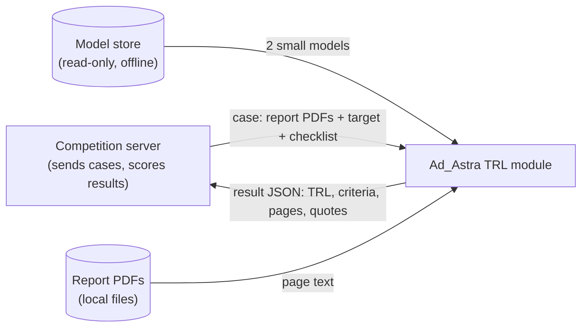
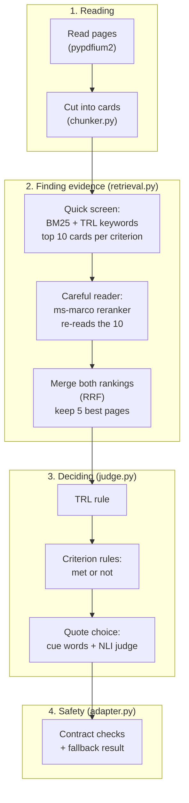
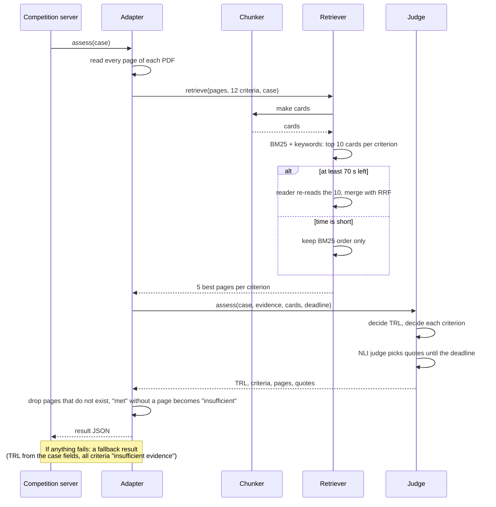
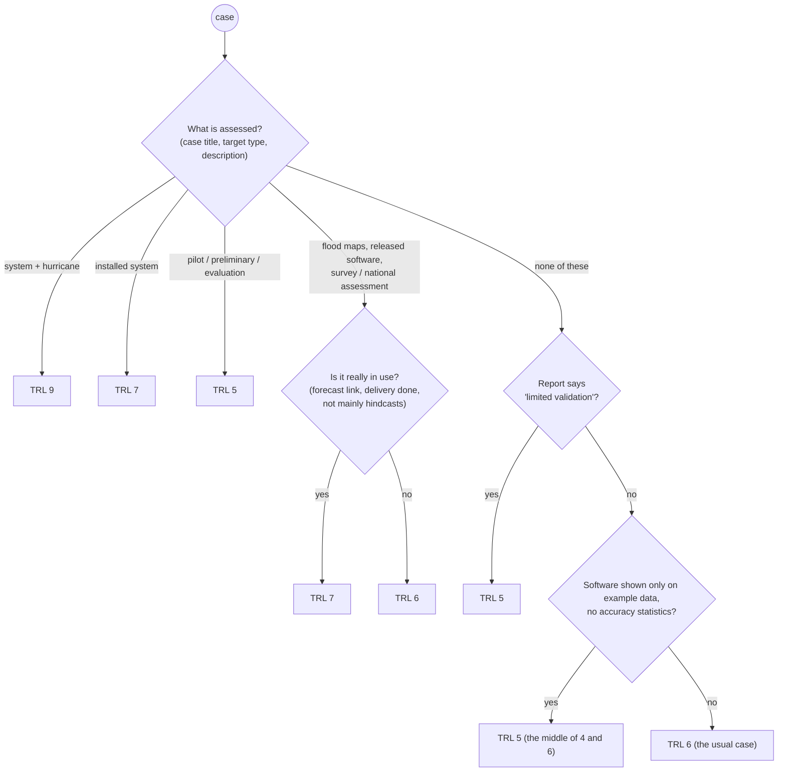
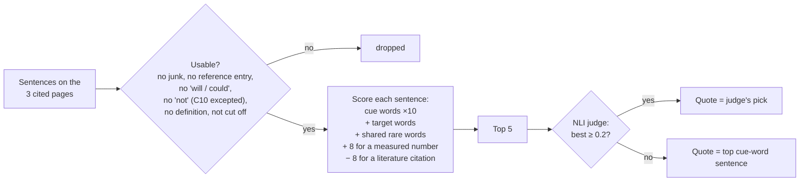
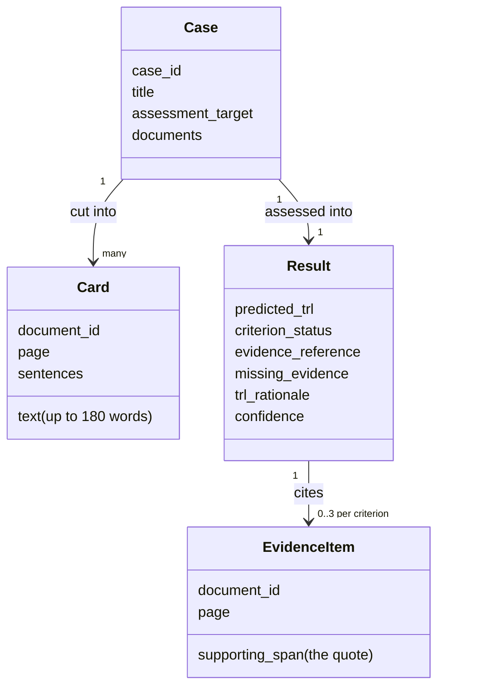

# Design document: Ad_Astra TRL assessment module

- **Team:** Ad_Astra (Garima Patel)
- **Version described:** Submission 2 (module version 1.1.0, `judge.py` fingerprint `218ea863`)
- **Date:** 12 November 2026
- **Companion notes:** the decision records in [`our-thought-process/`](our-thought-process/README.md) explain
  *why* each choice was made. This document explains *what* the system is and *how its parts fit together*.

---

## 1. Overview

**The problem.** A technical report (a PDF) describes a technology. Someone must decide how mature that technology
is, on the 1–9 **TRL** scale (Technology Readiness Level: 1 = an idea on paper, 9 = proven in real daily use), and
show *where in the report* the proof is. Doing this by hand takes an expert hours per report.

**What our module does.** For each case the competition server sends, the module:

1. reads every page of the report,
2. finds the pages most relevant to each of the 12 checklist criteria (C01–C12),
3. decides the TRL,
4. marks each criterion as **met** or **insufficient evidence**,
5. for each met criterion, cites up to 3 pages and quotes one sentence from the report as proof,
6. returns all of this as one JSON result that always follows the organizer's data contract.

**What it does *not* do.**

- It does not use the internet or any outside service; everything runs offline on a 4-core CPU.
- It does not invent text. Every quote is copied word for word from the report.
- It does not learn while running. All rules and models are fixed before submission.

**Assumptions and limits** (from the organizer's rules):

| Limit | Value |
|---|---|
| Time per case, model loading included | 180 s |
| Hardware | 4 CPU cores (a GPU is optional; we chose CPU only) |
| Models | only those in the organizer's read-only model store |
| Pages that count for a criterion | the first 3 distinct pages cited |
| Score | 0.45 × TRL score + 0.40 × criteria score + 0.15 × quote score |

### Context diagram

*Figure 1: Context diagram.*

**What to notice:** the module has only three neighbours, and it never talks to the internet. The server
gives it the case and gets back one result. The model store gives it two small models. The PDFs give it text.

---

## 2. Architecture: a pipeline of filters

We used the **pipe-and-filter** pattern. The data flows through a chain of steps, and each step does one job
and hands its output to the next. It's like an assembly line in a factory: each station adds one thing.

*Figure 2: The four stages of the module.*

**What to notice:**

- The two models do *small* jobs: the reader re-orders 10 cards, and the judge picks among 5 sentences. They
  never make the big decisions (the TRL, met or not). Those come from rules we can read and check.
- Every stage can run without its model. If a model is missing, the step falls back to plain word matching, and
  the result is still valid.

### The parts, one line each

| File | Job | Key settings |
|---|---|---|
| `adapter.py` | The class the server calls. Runs the pipeline, watches the clock, guarantees a valid result | reader only if ≥ 70 s left; judge stops 35 s before the end |
| `chunker.py` | Cleans pages (headers, footers, contents, references) and cuts them into **cards** (≤ 180 words, never across pages) | `MAX_WORDS = 180` |
| `simple_bm25.py` | Our own small BM25 word-matching index (no extra library) | standard BM25 |
| `keywords.py` | TRL keyword lists per criterion, cue words for quotes, the plain question asked to the reader | `CUES`, `question_for()` |
| `retrieval.py` | Finds the 5 best pages per criterion | `SHORTLIST = 10`, `KEEP_PAGES = 5`, `RRF_K = 60` |
| `judge.py` | TRL rule, criterion rules, quote choice | `CITE_PAGES = 3`, `CANDIDATES = 5`, `NLI_TRUST = 0.2` |

### The two models

| Model | Size | What it does here | Why this one |
|---|---|---|---|
| `cross-encoder/ms-marco-MiniLM-L6-v2` (the **reader**) | about 22 M parameters | Scores "does this card answer this question?" for the 10 shortlisted cards | Fast on a CPU, and it generalised best to reports we had never seen (note 005) |
| `MoritzLaurer/deberta-v3-base-zeroshot-v2.0-c` (the **NLI judge**) | about 184 M parameters | Scores "does this sentence support this claim?" for 5 candidate quotes | It understands entailment (does A support B), which is what a quote must do (note 006) |

---

## 3. How one case runs

*Figure 3: Sequence diagram for one case.*

**What to notice:** there are two "plan B"s built in. If time is short, the reader is skipped. If anything crashes,
the server still gets a valid answer, because a valid fallback scores more than a failed case. On the laptop, a
whole case takes 56–75 s, well inside the 180 s limit.

---

## 4. How the TRL is decided

*Figure 4: Activity diagram of the TRL rule (`meta_trl`, `operational_check`, `decide_trl` in `judge.py`).*

**What to notice:**

- The first question looks at the **case description**, not the report. What is being assessed already says a
  lot: an installed monitoring system is usually TRL 7, and a pilot study is usually TRL 5.
- TRL 6 is the default because 54 of the 99 public cases are TRL 6.
- "TRL 5, the middle" is a deliberate **hedge**. When a report could honestly be a 4 or a 6, answering 5 earns half
  a point either way, instead of gambling for 1 or 0 (note 013).

---

## 5. How each criterion is decided

The 12 criteria fall into four groups, and each group has its own rule:

| Group | Criteria | Rule | Why |
|---|---|---|---|
| **Usual pattern** | C01–C03 (principles, concept, proof), C11 (test conditions), C12 (about the target) | Always **met**, if a relevant page exists | Almost every report in this collection has these; the score punishes a missed "met" twice as hard as a false one (note 006) |
| **Follows the TRL** | C05–C09 (TRL 5–9 steps) | **Met** for every level up to the decided TRL | A TRL 6 technology has, by definition, passed the TRL 5 and 6 steps |
| **Needs a deciding sentence** | C04 (lab or controlled test), C10 (results against stated requirements) | **Met** only if a sentence with the right cue words is found ("example data", "met the criteria", "satisfactory") | These really vary between reports |
| **Unknown** (a renamed or new criterion) | any | **Met** only if the NLI judge is at least 80% sure | A safe default if the checklist changes |

### How the quote is chosen

*Figure 5: How the quote for a met criterion is chosen.*

**What to notice:** the quote is always a real sentence from the report, so it can never be "fabricated"
(fabrication scores −1). The cheap cue-word score narrows hundreds of sentences down to 5, and only then does the
slower model read them.

---

## 6. What goes in and what comes out

*Figure 6: The main data. A case becomes many cards; the result cites at most 3 pages per criterion.*

---

## 7. Robustness: what happens when things go wrong

| If this happens… | …the module does this | Tested |
|---|---|---|
| The reader model is missing | Uses BM25 order only | Yes, "safety mode": TRL score unchanged, criteria score 0.816 / 0.867 |
| The NLI judge is missing or slow | Uses the top cue-word sentence as the quote | Yes |
| Less than 70 s left after reading | Skips the reader | Yes (40 s test) |
| A PDF has no text (a scan) | Criteria "insufficient evidence", TRL from the case fields | Yes |
| A file cannot be read, or any crash | Valid fallback result | Yes |
| Criterion IDs are renamed | Roles are found from the description text, not the ID | Yes |
| A cited page does not exist | Dropped; a "met" with no page left becomes "insufficient evidence" | Yes |

---

## 8. Key design decisions

Each row is backed by a decision record. "Rejected" options were measured, not guessed.

| Decision | Chosen | Rejected (and why) | Note |
|---|---|---|---|
| PDF reader | pypdfium2 | pypdf (compared in note 001) | 001 |
| Finding evidence | BM25 shortlist + small reranker | Embeddings alone; large rerankers (too slow on a CPU); tuned word lists alone (overfitted on unseen reports) | 002–005 |
| Met or not | Usual-pattern rules + cue sentences | NLI judge as decider (110–147 s per report, and 0.61 vs 0.73) | 006 |
| TRL | Hand-written rule from the case description | Trained model (0.83–0.87 vs 0.914 in 5-fold checks); TF-IDF words (0.79–0.81, learned topics like "fish" and "Arizona", not maturity) | 007, 012 |
| TRL refinements | "Really in use?" check + middle-answer hedge | — (4 fixes, 0 breaks on 70 open reports; sealed lockbox unchanged) | 013 |
| Quotes | Cue-word ranking + NLI pick of 5 | Reader-picked quotes (18 fewer supporting quotes); extra junk filters (0 gained); new C01 cue words (0 net) | 009 (quote tests of 12 Nov to be written up) |
| Answer keys | One labelling rule for all reports | Ad hoc labels (inconsistent, made numbers untrustworthy) | 008 |

---

## 9. How we know it works

| Check | Result (Submission 2 version) |
|---|---|
| TRL on 70 open public reports (organizer's TRL) | 0.943 (rule before note 013: 0.914; always answering 6: 0.743) |
| TRL on 29 sealed lockbox reports (opened once) | 0.948 |
| Our 9 studied reports, real models | TRL 0.889, criteria 0.824 |
| 3 reports never opened while building | TRL 1.000, criteria 0.893 |
| Quotes that support their criterion (our labels, 93 quotes) | about half fully, a quarter partly |
| Valid results | 12 / 12 locally; Submission 1 receipt: VALID, PASS |
| Time per case | 56–75 s (limit 180 s) |

The same discipline was used for every change: count **fixes vs breaks** on reports, never accept a change that
breaks more than it fixes, and keep a sealed **lockbox** that no rule was tuned on.

---

## 10. Known limits and future work

- **Quotes are the weakest part.** About half fully support their criterion. Three cheap fixes were tested and none
  generalised. The next real step needs a model that reasons about sentences, for example a larger catalogue model on the
  event machine's GPU. The package is frozen after submission (Stage 2 uses it unchanged), so this is future work.
- **TRL 4, 8 and 9 are rare** in the public cases (1, 1 and 2 reports), so the rule has little evidence for them.
- **The rule is tuned to this report collection** (U.S. Geological Survey style reports). A very different kind of
  report would mostly fall to the default TRL 6.

---

## Glossary

| Term | Plain meaning |
|---|---|
| TRL | Technology Readiness Level, 1 (idea) to 9 (proven in real use) |
| Card | A piece of one page, at most about 180 words |
| BM25 | A classic word-matching score: counts shared words, giving rare words more weight |
| Reranker / reader | A small model that re-reads a short list and puts the best answer first |
| RRF | Reciprocal Rank Fusion: merges two ranked lists by adding 1 / (60 + rank) from each |
| NLI | Natural Language Inference: does sentence A support, contradict, or say nothing about claim B |
| Cue words | Words that signal evidence for a criterion, e.g. "calibrated", "met the criteria" |
| Hedge | Answering the middle level when the truth could be one below or one above |
| Lockbox | Reports sealed away at the start and used only once, to check that we did not overfit |
| Pipe-and-filter | An architecture where data passes through a chain of steps, each doing one job |
