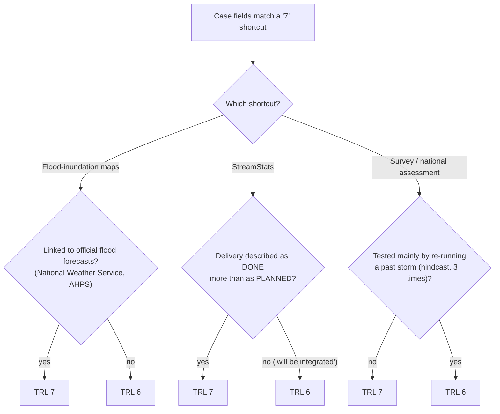
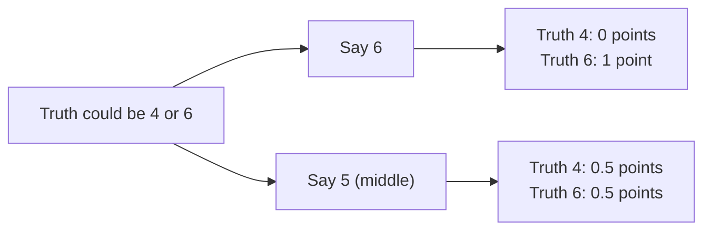
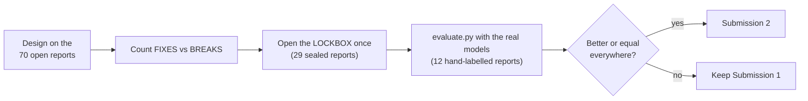

# 013: Smarter TRL rule: "is it really in use?" and "answer the middle when unsure"

- **Status:** Accepted (goes into Submission 2)
- **Area:** `participant_module/judge.py` (TRL rule, C10 quote filter); test script `training/lockbox_check.py`
- **Date:** 11 November 2026

## In one sentence

We taught the TRL rule to ask **one extra question** before saying TRL 7, to **answer the middle level** when a
report could honestly be a 4 or a 6, and to accept "**did not meet the criteria**" sentences as C10 evidence.

## Where we started

Our hand-written rule already scored well: **0.914** on the 70 open public reports (organizer's estimated TRL).
It still got 11 reports wrong. We grouped the mistakes and picked the two groups that make sense in TRL terms:

| Group | What went wrong | Reports |
|---|---|---|
| **B** | Rule said **7**, organizer said **6** | 037, 068, 092 |
| **C** | Rule said **6**, organizer said **4** (software only tested on example data) | 012 |

Before this, we also tried letting the computer find clues by itself: counting every word (TF-IDF) and ranking
the words that differ between TRL 5 and TRL 6 ("Fightin' Words"). It scored **0.79–0.81**, worse than the rule. The
"TRL 5 words" it found were **topics**, not maturity: *fish, drainage, wetland, Arizona*. With only 8 TRL-5 reports,
coincidences win (see note 012).

## Change 1 (group B): "Is it really in use?"

Our rule has shortcuts that jump to **TRL 7** (operational). Now each shortcut must show **real use** in the report.
If it doesn't, the answer is **6** (demonstrated, not yet operational).

**Why it makes sense:** a map is "in operational use" when people get it **together with real flood forecasts**;
software is operational when it **has been** delivered, not when it **will be**; re-running an old storm is a
**test**, not daily use.

| Report | Before | After | Organizer |
|---|---|---|---|
| 037 flood maps (0 forecast links; every true-7 map report has 8+) | 7 | **6** | 6 |
| 068 StreamStats ("will be integrated" ×3, "has been" ×1) | 7 | **6** | 6 |
| 092 coastal erosion assessment ("hindcast" ×7) | 7 | **6** | 6 |

## Change 2 (group C): "Answer the middle when unsure" (hedging)

Report 012 is new **software**, shown only on **example data**, with **no accuracy numbers** against real
measurements. Experts could call that a 4 (lab-tested) or a 6 (working model). Scoring gives **half a point** for
being one level off, so answering the **middle** is safest:

Rule: *target is software* **and** *2+ mentions of example/test data, source code or installation* **and** *no
accuracy statistics (RMSE, Nash–Sutcliffe, R², percent error…)* → **TRL 5**. 012 goes from 6 to **5**.

## Change 3 (C10): "did not meet the criteria" counts

Our quote filter drops sentences with "not", because they are usually weak evidence. The organizers clarified
(10 Nov) that **C10 is met when results are compared with a stated requirement and the outcome is reported, even
if the requirement was not achieved.** So for C10 only, a sentence such as *"The model did not meet the criteria
for satisfactory fit"* is now allowed. No other criterion changes (checked: 0 differences).

## How we tested (the same discipline as always)

### Results

| Test | Before (Submission 1) | After | What it means |
|---|---|---|---|
| 70 open reports: TRL score | 0.914 | **0.943** | 4 fixed (012, 037, 068, 092), **0 broken** |
| 29 lockbox reports: TRL score | 0.948 | 0.948 | **No change**: none of the new checks fired, so they are **safe** (nothing broken), but the lockbox had no fresh case to confirm a gain |
| 9 studied reports: TRL (A) | 0.833 | **0.889** | 012 now half right |
| 9 studied reports: criteria (B) | 0.816 | **0.824** | no longer claims C06 for 012 |
| 9 studied reports: quote on a correct page | 33/64 | 33/64 | unchanged |
| 3 unseen reports | A 1.000, B 0.893 | identical | nothing got worse |
| Valid results | 12/12 | 12/12 | |
| Time per report (real models, our laptop, 11 Nov) | 56–62 s | 56–62 s | same; our laptop was slower that day; limit 180 s |

Estimated A+B share of the score (out of 0.85): studied reports **0.702 → 0.730**, unseen reports 0.807 → 0.807.

## Limits, honestly

- Each check was designed from **one example**, so on hidden reports it may fire less cleanly. The flood-map check
  has a wide margin (0 vs 8+ mentions); the StreamStats one is thin (3 vs 1).
- The lockbox could only show "**no harm**", not "**more points**".
- Every new reason is written into `trl_rationale`, so an assessor can see **why** the module said 6 or 5.
