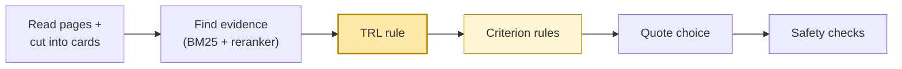

# Submission 1 vs Submission 2

**Team Ad_Astra (Garima Patel)** · Submission 1: version 1.0.0, 26 October 2026 · Submission 2: version 1.1.0, November 2026

> **In one line:** Submission 2 is Submission 1 with a smarter TRL rule. Only one file changed (`judge.py`). Reading,
> retrieval, the models and the quote method are the same.

## Where the change sits

*Yellow: changed in Submission 2. The TRL rule got two new checks; the criterion rules got one small fix (C10).
Everything else is byte-for-byte the same as Submission 1.*

## What changed, in plain words

| # | Change | Before (S1) | After (S2) | Why it makes sense |
|---|---|---|---|---|
| 1 | **"Is it really in use?"** | Flood maps, released software and surveys were always TRL 7 | Each must show real use in the report, else TRL 6 | A map is operational when people get it with real flood forecasts; software is operational when it *has been* delivered, not when it *will be*; re-running an old storm is a test, not daily use |
| 2 | **"Answer the middle when unsure"** | New software shown only on example data → TRL 6 | → TRL 5 | It could honestly be a 4 or a 6. A 5 earns half a point either way, instead of gambling for 1 or 0 |
| 3 | **C10 negative verdicts** | "did not meet the criteria" was dropped (sentences with "not" were filtered out) | Counts as C10 evidence | The organizers clarified on 10 November that C10 is about *reporting* the comparison, even when the requirement was not met |

## What stayed the same

| Part | Same as S1? |
|---|---|
| `adapter.py`, `chunker.py`, `retrieval.py`, `keywords.py`, `simple_bm25.py` | Yes, identical files |
| The two models (ms-marco reader, DeBERTa NLI judge) | Yes |
| How quotes are chosen | Yes (three quote changes were tested and rejected; see below) |
| Licence, base environment, no trained model shipped | Yes |

## Results

| Check | S1 | S2 | Change |
|---|---|---|---|
| TRL score on 70 open public reports | 0.914 | **0.943** | 4 reports fixed (012, 037, 068, 092), 0 broken |
| TRL score on 29 sealed reports | 0.948 | 0.948 | no report changed: safe |
| Our 9 studied reports: TRL / criteria | 0.833 / 0.816 | **0.889 / 0.824** | 012 now off by one (half a point) instead of two; criteria up slightly from the C10 fix |
| 3 reports never opened while building | 1.000 / 0.893 | 1.000 / 0.893 | same |
| Valid results | 12 / 12 | 12 / 12 | same |

**The clearest example, report 012:** the organizer says TRL 4. Submission 1 said 6 (off by two, 0 points). Submission 2
says 5 (off by one, half a point). It is also one of the kit's three check cases, so the organizer's diagnostic run
should now show **012 → 5**.

## What we tried and did *not* ship

| Idea | Result | Decision |
|---|---|---|
| A trained TRL model (5-fold checks) | 0.83–0.87, below the rule's 0.914 | Rejected (note 012) |
| Word counting (TF-IDF) to find TRL clues | 0.79–0.81; it learned topics like "fish" and "Arizona", not maturity | Rejected (note 012) |
| The reader model picking quotes | 18 fewer good quotes on studied reports, 4 fewer on unseen | Rejected |
| Extra junk filters for quotes | 0 good quotes gained | Rejected |
| New cue words for C01 quotes | one fixed, one broken: net 0 | Rejected |

Our rule for every change: count **fixes vs breaks**, and never ship a change that does not clearly win.
