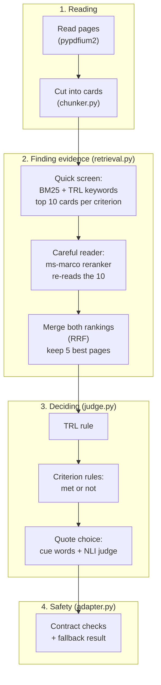
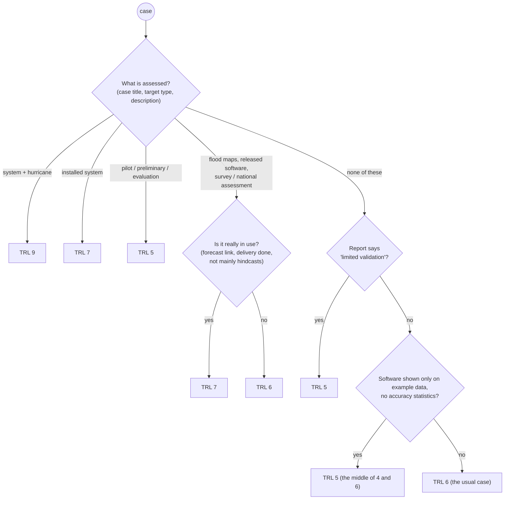

# Summary: Ad_Astra TRL assessment module

**Team Ad_Astra (Garima Patel)** · Submission 2 (version 1.1.0) · 12 November 2026

> **In one line:** the module reads a technical report, decides its Technology Readiness Level (TRL 1–9), marks
> the 12 checklist criteria as met or not, and backs every "met" with page numbers and a sentence copied word for
> word from the report. It runs offline on a 4-core CPU in about one minute per report.

More detail: [design document](design-document.md) (how it is built) · [our thought process](our-thought-process/README.md)
(why each choice was made, with the evidence).

---

## The pipeline

*The four stages. The data flows down like an assembly line: each stage does one job and hands its output on.*

**What to notice:**

- **Reading:** each page is cleaned (headers, footers, contents and references removed) and cut into **cards**, pieces
  of at most about 180 words.
- **Finding evidence:** a fast word-matching score (BM25) shortlists 10 cards per criterion. A small model (the
  reader) re-reads only those 10, and both rankings are merged. This gives the 5 best pages per criterion.
- **Deciding:** readable **rules** decide the TRL and whether each criterion is met. A second small model (the NLI
  judge) only picks the best of 5 candidate quotes.
- **Safety:** pages that don't exist are dropped. If anything fails, a valid fallback answer is returned, because a
  valid answer always scores more than a failed case.
- Both models are small (22 M and 184 M parameters). The module still gives a valid result if either one is
  missing.

---

## How the TRL is decided

*TRL 6 is the default because 54 of the 99 public cases are TRL 6. Answering "5, the middle" when a report could
be a 4 or a 6 earns half a point either way, instead of gambling for 1 or 0.*

## How each criterion is decided

| Group | Criteria | Rule |
|---|---|---|
| Usual pattern | C01–C03, C11, C12 | Met, if a relevant page exists |
| Follows the TRL | C05–C09 | Met for every level up to the decided TRL |
| Needs a deciding sentence | C04 (lab / controlled test), C10 (results vs requirements) | Met only if a sentence with the right cue words is found |
| Unknown or renamed criterion | any | Met only if the NLI judge is at least 80% sure |

---

## Results

| Check | Result |
|---|---|
| TRL on 70 open public reports | **0.943** (always answering 6: 0.743) |
| TRL on 29 sealed "lockbox" reports, opened once | **0.948** |
| Our 9 studied reports (TRL / criteria) | 0.889 / 0.824 |
| 3 reports never opened while building (TRL / criteria) | 1.000 / 0.893 |
| Valid results | 12 / 12 locally; Submission 1 receipt: VALID, PASS |
| Time per case | 56–75 s (limit 180 s) |

---

## Key decisions (measured, not guessed)

| Decision | Chosen | Rejected, and why |
|---|---|---|
| Finding evidence | BM25 shortlist + small reranker | Tuned word lists alone overfitted on unseen reports; large models were too slow on a CPU |
| Met or not | Usual-pattern rules + cue sentences | NLI judge as the decider: slower (110–147 s per report) and less accurate (0.61 vs 0.73) |
| TRL | Hand-written rule | Trained model (0.83–0.87 vs 0.914); word-counting (TF-IDF) learned topics like "fish" and "Arizona", not maturity |
| TRL refinements | "Really in use?" check + middle-answer hedge | None needed: 4 fixes, 0 breaks, lockbox unchanged |
| Quotes | Cue-word ranking + NLI pick of 5 | Reader-picked quotes (18 fewer good quotes); extra junk filters and new cue words (no net gain) |

Our rule for every change: count **fixes vs breaks** across reports, and never accept a change that breaks more
than it fixes.

---

## Known limits and next steps

- **Quotes are the weakest part:** about half fully support their criterion. Cheap fixes did not generalise; the next
  step is a model that reasons about sentences (for example a larger model on a GPU). The package is frozen after
  submission, so this is future work.
- **TRL 4, 8 and 9 are rare** in the public cases (1, 1 and 2 reports), so the rule has little evidence for them.
- **Tuned to this report collection** (U.S. Geological Survey style). A very different kind of report would mostly
  fall to the default TRL 6.
